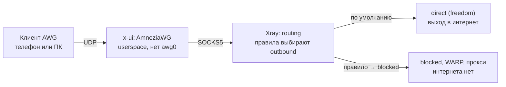

# 3x-ui + AmneziaWG: нет интернета через VPN

Инструкция по диагностике для 3x-ui v3.11.0 и Ubuntu 26.04, актуальна на 28.10.2026.

Симптом: клиент подключается к AWG, handshake проходит, локальная сеть (172.x) доступна, а интернета нет.

## Содержание

0. [Как это устроено и почему NAT не нужен](#0-как-это-устроено-и-почему-nat-не-нужен)
1. [Быстрая диагностика с клиента](#1-быстрая-диагностика-с-клиента)
2. [Сервер Ubuntu 26.04](#2-сервер-ubuntu-2604)
3. [Inbound AmneziaWG в панели](#3-inbound-amneziawg-в-панели)
4. [Outbounds и Routing в настройках Xray](#4-outbounds-и-routing-в-настройках-xray)
5. [DNS](#5-dns)
6. [MTU](#6-mtu)
7. [Логи: как включить и что искать](#7-логи-как-включить-и-что-искать)
8. [Готовые JSON для настроек Xray](#8-готовые-json-для-настроек-xray)
9. [Конфиг клиента AmneziaWG](#9-конфиг-клиента-amneziawg)
10. [Чек-лист по порядку](#10-чек-лист-по-порядку)

Готовые файлы конфигов лежат в папке [`configs/`](configs/).

---

## 0. Как это устроено и почему NAT не нужен

В этом режиме интернет клиенту даёт не ядро Ubuntu, а Xray. Поэтому причину ищем в маршрутизации Xray, DNS, логах и версии панели, а не в iptables.

С версии 3.7.0 AmneziaWG встроен в 3x-ui: процесс x-ui сам поднимает userspace-стек (amneziawg-go + gVisor), поэтому в `ip a` нет интерфейса `awg0` или `wg0`. Расшифрованный трафик клиента панель передаёт в Xray через служебный SOCKS5-вход на loopback. Дальше он идёт по правилам routing в outbound, обычно `direct` (freedom).



Что из этого следует:

- `ip_forward`, MASQUERADE и правила FORWARD на этот трафик не влияют. Они нужны только в опциональном kernel-режиме AWG, который появился в v3.11.0.
- Handshake делает сам процесс x-ui, а не Xray. Картина «клиент подключён, handshake есть, интернета нет» типична, когда Xray остановлен, не запустился из-за конфига или отправляет трафик в `blocked`.
- ICMP через SOCKS не проходит. `ping 8.8.8.8` через такой туннель не работает даже при исправном VPN, проверяйте через curl, браузер и nslookup.
- Доступ к 172.x ничего не доказывает. Если это локальная сеть клиента (дом, офис), клиент ходит туда мимо туннеля.

## 1. Быстрая диагностика с клиента

Три проверки при включённом VPN за минуту показывают, где сломано: в выходе Xray, в DNS или в MTU. На Windows вместо `curl` пишите `curl.exe`, на телефоне откройте `http://1.1.1.1` в браузере.

```bash
curl -I http://1.1.1.1
nslookup google.com 1.1.1.1
nslookup google.com
```

| Что видите | Где проблема | Куда смотреть |
| --- | --- | --- |
| `curl -I http://1.1.1.1` не отвечает | трафик не выходит из Xray | разделы 2, 4, 7 |
| curl по IP работает, `nslookup google.com 1.1.1.1` нет | не проходит UDP через туннель | разделы 2, 7; обновите панель |
| `nslookup ... 1.1.1.1` работает, `nslookup google.com` нет | неверный DNS в конфиге клиента | раздел 5 |
| всё отвечает, но сайты виснут или грузятся частично | MTU | раздел 6 |

Дополнительно посмотрите в приложении-клиенте счётчики трафика. Если «отправлено» растёт, а «получено» стоит почти на нуле, пакеты доходят до сервера, но ответы не возвращаются: проблема на стороне Xray или выхода сервера.

## 2. Сервер Ubuntu 26.04

Сервер должен сам выходить в интернет, x-ui и Xray должны работать, а сама панель — быть свежей: в нескольких версиях чинили именно передачу трафика AWG в Xray.

1. **Сервис и ошибки.** В панели на Overview статус Xray должен быть «Running». В консоли:
   ```bash
   sudo systemctl status x-ui --no-pager
   sudo journalctl -u x-ui -n 150 --no-pager | grep -iE "amnezia|xray|error|bind|port"
   ```
   Ищите ошибки запуска Xray, конфликты портов и сообщения amneziawg.

2. **Порт AWG слушается.** Должен быть процесс x-ui:
   ```bash
   sudo ss -ulpn | grep <порт_AWG>
   ```
   Раз handshake проходит, входящий UDP открыт, и ufw с фаерволом провайдера можно не трогать.

3. **Интернет у самого сервера.**
   ```bash
   curl -4 -sS https://www.cloudflare.com/cdn-cgi/trace
   curl -6 -sS https://www.cloudflare.com/cdn-cgi/trace
   resolvectl status
   ```
   Если IPv4 не работает, проблема у хостера. Если не работает только IPv6, в Xray нельзя использовать стратегии `UseIPv6` и `ForceIPv6`, а в DNS лучше задать `queryStrategy: UseIPv4` (раздел 8).

4. **Ключевой тест: выход Xray без AWG.** Создайте в панели временный inbound **Mixed**: listen `127.0.0.1`, порт `10808`, без авторизации, UDP включён ([`configs/mixed-test-inbound.json`](configs/mixed-test-inbound.json)). Затем на сервере:
   ```bash
   curl -sS -x socks5h://127.0.0.1:10808 https://www.cloudflare.com/cdn-cgi/trace
   ```
   Ответ пришёл — Xray выходит в интернет, и сломан мост AWG→Xray: обновите панель (пункт 5) и смотрите логи (раздел 7). Ответа нет — проблема в outbounds или routing (раздел 4). После теста inbound удалите.

5. **Обновите 3x-ui до v3.11.0.** В v3.8.5 исправили выделение loopback-портов моста AWG: на базах с большим счётчиком id инбаундов протокол раньше вообще не работал. В v3.11.0 исправили ситуацию, когда служебный порт выхода AWG совпадал с портом Xray API или relay. Перед обновлением сделайте копию базы:
   ```bash
   sudo cp /etc/x-ui/x-ui.db ~/x-ui.db.bak
   x-ui update
   ```

6. **Песочница systemd (v3.10.0+).** Сервис теперь работает с read-only `/etc`, `/usr`, `/home`, `/root`, кроме своих папок. Если вы задали Xray свой путь к логам или файлам вне папок панели, Xray может не стартовать. Либо верните стандартный путь, либо добавьте его через `ReadWritePaths=` в `/etc/systemd/system/x-ui.service.d/20-local.conf`, затем:
   ```bash
   sudo systemctl daemon-reload && sudo systemctl restart x-ui
   ```

## 3. Inbound AmneziaWG в панели

Раз handshake проходит, ключи и параметры обфускации совпадают. Здесь проверяем то, что влияет на трафик после handshake.

- **Режим работы.** По умолчанию используется встроенный userspace-режим. С v3.11.0 для отдельного inbound можно включить kernel-режим: он работает через NAT, ставит модуль своим установщиком и проверяет хост перед запуском. Если включите его, тогда уже станут важны `ip_forward` и iptables.
- **Клиент включён и не исчерпал лимиты.** Проверьте срок действия, квоту трафика и HWID-лимит.
- **Адрес клиента.** У каждого клиента должен быть уникальный адрес вида `10.x.x.x/32`. С v3.9.0 пересекающиеся `allowedIPs` у разных клиентов панель не сохраняет, а старые пересечения ломают маршрут ответов одному из клиентов.
- **Актуальный конфиг клиента.** После любой правки inbound заново скачайте `.conf`, QR или `vpn://`-ссылку. Значения Jc, Jmin, Jmax, S1–S4, H1–H4 и I1–I5 должны совпадать с сервером один в один.
- **MTU inbound'а.** Безопасно 1280; подробнее в разделе 6.
- **Последний handshake.** На Overview откройте логи AmneziaWG: там видно, каким пирам и когда был handshake.

## 4. Outbounds и Routing в настройках Xray

Трафик, не попавший ни под одно правило, Xray отправляет в первый outbound списка. Поэтому первым должен стоять `direct` (freedom), а правила не должны уводить трафик AWG в `blocked` или нерабочий прокси.

1. **Порядок outbounds.** Настройки Xray → Outbounds: первым должен быть `direct` с протоколом freedom. Если первым стоит WARP, другой сервер или `blocked`, поднимите `direct` наверх.
2. **Domain strategy у freedom.** С v3.8.0 она хранится в `streamSettings.sockopt.domainStrategy`, а не в `settings`. Нужно `AsIs` или `UseIPv4`. `UseIPv6` и `ForceIPv6` без IPv6 на сервере ломают соединения.
3. **Правила, которые режут всё.** Во вкладке Routing ищите правила с `outboundTag: blocked` (или на WARP либо прокси) с условиями вида:
   - `network: tcp,udp`;
   - `ip: 0.0.0.0/0` или `::/0`;
   - `port: 0-65535` или `1-65535`;
   - `inboundTag` с тегом вашего AWG-инбаунда.

   Временно отключите подозрительное правило и проверьте снова.
4. **Lua-скрипт маршрутизации (v3.10.0+).** Если в Basics заполнено поле routing script, обычные правила Routing пропускаются. Если вы его не задавали намеренно, очистите поле.
5. **WARP и балансировщики.** Если весь трафик направлен в WARP или балансировщик, а он не поднимается, интернета не будет ни у кого. Временно направьте трафик в `direct`.
6. **Встроенные правила freedom.** С v3.6.0 стандартный freedom блокирует выход в частные сети (`geoip:private`). На интернет это не влияет, только на доступ к локальной сети за сервером.

Самый быстрый способ исключить ошибку шаблона: сохраните текущий JSON настроек Xray себе, затем замените разделы `routing` и `outbounds` на чистые из раздела 8.

## 5. DNS

Если по IP сайты открываются, а по именам нет, дело в DNS. Чаще всего в конфиге клиента указан адрес, на котором никто не отвечает.

- **DNS в конфиге клиента.** Укажите публичные серверы: `DNS = 1.1.1.1, 8.8.8.8`. Не используйте адрес шлюза туннеля (например `10.0.0.1`), если панель явно не говорит, что он обслуживает DNS: во встроенном режиме на нём ничего не слушает.
- **DNS-outbound в шаблоне Xray.** Если в шаблоне есть outbound `dns-out` и правило «порт 53 → dns-out», проверьте его правила. В версиях около 3.8.0 сохранённое правило с типом запроса `0` блокировало вообще все DNS-запросы. Миграция в v3.8.5 это исправляет, поэтому обновитесь или удалите такое правило вручную.
- **Блок `dns` в Xray.** Серверы из него должны быть доступны с сервера. Если на сервере нет IPv6, задайте `queryStrategy: UseIPv4`.
- **Проверка с клиента:** `nslookup google.com 1.1.1.1` при включённом VPN должен вернуть адрес.

## 6. MTU

Слишком большой MTU даёт характерную картину: мелкие запросы проходят, а HTTPS-сайты зависают на загрузке или грузятся частично. Значение 1280 работает почти везде.

- Поставьте `MTU = 1280` в конфиге клиента и то же значение в inbound'е.
- Если в обфускации задан S4 (паддинг пакетов данных в AWG 2.0+), каждый пакет становится длиннее на S4 байт. Держите MTU не выше 1420 минус S4.
- Проверить MTU пути до сервера можно с клиента при выключенном VPN. Linux: `ping -M do -s 1372 <IP_сервера>`. Windows: `ping -f -l 1372 <IP_сервера>`. Если пакет не проходит, уменьшайте размер, пока не пройдёт: MTU туннеля ≈ найденный размер + 28 − 80 − S4.
- В v3.8.0 во встроенном туннеле исправили несколько ошибок с MTU, так что на старых версиях обновление может помочь само по себе.

## 7. Логи: как включить и что искать

Лог Xray сразу показывает, доходит ли трафик клиента до Xray и в какой outbound он уходит. Это самый короткий путь к причине.

1. Настройки Xray → Basics → Log: уровень `info` (для разбора можно `debug`), access-лог включите выбором из списка. Свой путь не вписывайте: с v3.8.0 панель ограничивает пути логов, а с v3.10.0 сервис пишет только в свои папки.
2. Сохраните настройки и перезапустите Xray.
3. Подключитесь клиентом и откройте пару сайтов.
4. Смотрите логи на Overview (логи Xray и логи AmneziaWG) или в консоли:
   ```bash
   sudo journalctl -u x-ui -f
   ```

| Что в логе | Что это значит | Что делать |
| --- | --- | --- |
| `accepted ... [<тег> -> direct]` | трафик дошёл до Xray и ушёл наружу | проблема дальше: DNS (раздел 5), MTU (раздел 6) |
| `-> blocked` | трафик режет правило маршрутизации | найти и отключить правило (раздел 4) |
| `failed to dial`, `i/o timeout`, `connection refused` | сервер не может выйти наружу | интернет сервера, IPv6, domainStrategy (разделы 2, 4) |
| handshake в логах AWG есть, записей в логе Xray нет | трафик не доходит от моста AWG до Xray | обновить панель, смотреть journal (раздел 2) |
| Xray не запущен или перезапускается | ошибка в конфиге или конфликт портов | текст ошибки в journal, откатить последние правки |

После разбора верните уровень `warning`: на `debug` лог быстро растёт.

## 8. Готовые JSON для настроек Xray

Заменяйте только разделы `log`, `dns`, `routing` и `outbounds`. Служебные части шаблона (`api`, `stats`, `policy`, inbound с тегом `api`) панель использует для статистики и управления, их не трогайте. Перед правкой скопируйте текущий JSON себе.

Где править: Настройки Xray → расширенный редактор JSON шаблона.

Все четыре раздела одним файлом: [`configs/xray-template-parts.json`](configs/xray-template-parts.json).

**Раздел `log`.** Путь access-лога выберите в Basics, в JSON его не вписывайте.

```json
"log": {
  "loglevel": "info",
  "dnsLog": false
}
```

**Раздел `dns`.**

```json
"dns": {
  "servers": [
    "1.1.1.1",
    "8.8.8.8"
  ],
  "queryStrategy": "UseIPv4"
}
```

**Раздел `outbounds`.** `direct` обязательно первый. Если на сервере есть рабочий IPv6, `UseIPv4` можно заменить на `AsIs`.

```json
"outbounds": [
  {
    "tag": "direct",
    "protocol": "freedom",
    "settings": {},
    "streamSettings": {
      "sockopt": {
        "domainStrategy": "UseIPv4"
      }
    }
  },
  {
    "tag": "blocked",
    "protocol": "blackhole",
    "settings": {}
  }
]
```

**Раздел `routing`.** Первое правило нужно панели для API, второе блокирует торренты (его можно убрать). Всё остальное уходит в первый outbound, то есть в `direct`.

```json
"routing": {
  "domainStrategy": "AsIs",
  "rules": [
    {
      "type": "field",
      "inboundTag": ["api"],
      "outboundTag": "api"
    },
    {
      "type": "field",
      "protocol": ["bittorrent"],
      "outboundTag": "blocked"
    }
  ]
}
```

**Временный тестовый inbound Mixed** для проверки из раздела 2, пункт 4. Создайте его через форму: протокол Mixed, listen `127.0.0.1`, порт `10808`. Его настройки в JSON ([`configs/mixed-test-inbound.json`](configs/mixed-test-inbound.json)):

```json
{
  "auth": "noauth",
  "udp": true
}
```

После сохранения перезапустите Xray и убедитесь, что на Overview статус «Running». Если панель отказалась сохранять конфиг (с v3.10.0 она отклоняет конфиги, с которыми Xray не запустится), в сообщении будет указана причина.

## 9. Конфиг клиента AmneziaWG

Берите конфиг, который генерирует панель, и меняйте в нём только `DNS`, `MTU` и `AllowedIPs`. Параметры обфускации вручную не переписывайте: при любом расхождении handshake перестанет проходить.

Шаблон: [`configs/client-awg.conf.example`](configs/client-awg.conf.example).

```ini
[Interface]
PrivateKey = <ключ клиента из панели>
Address = 10.0.0.2/32
DNS = 1.1.1.1, 8.8.8.8
MTU = 1280
# Ниже значения из панели, без изменений:
Jc = ...
Jmin = ...
Jmax = ...
S1 = ...
S2 = ...
S3 = ...
S4 = ...
H1 = ...
H2 = ...
H3 = ...
H4 = ...
# I1–I5, если панель их выдала

[Peer]
PublicKey = <публичный ключ сервера>
AllowedIPs = 0.0.0.0/0, ::/0
Endpoint = <IP_сервера>:<порт_AWG>
PersistentKeepalive = 25
```

- `AllowedIPs = 0.0.0.0/0, ::/0` направляет в туннель весь трафик. Если на сервере нет IPv6, можно оставить только `0.0.0.0/0`.
- Чтобы локальная сеть клиента (например 172.x или 192.168.x) работала при VPN, включите в приложении Amnezia опцию доступа к локальной сети или исключите эти подсети из маршрута.
- С v3.11.0 `PersistentKeepalive` может быть диапазоном, например `15-25`.

## 10. Чек-лист по порядку

- [ ] С клиента: `curl -I http://1.1.1.1` и `nslookup google.com 1.1.1.1` при включённом VPN
- [ ] Overview: Xray в статусе «Running», ошибок в `journalctl -u x-ui` нет
- [ ] Сервер сам выходит в интернет по IPv4
- [ ] Тест через временный Mixed на `127.0.0.1:10808` проходит
- [ ] Сделана копия `/etc/x-ui/x-ui.db`, панель обновлена до v3.11.0
- [ ] Первый outbound — `direct` (freedom), domainStrategy `AsIs` или `UseIPv4`
- [ ] Нет правил, уводящих AWG-трафик в `blocked`, WARP или нерабочий прокси; поле routing script пустое
- [ ] В конфиге клиента `DNS = 1.1.1.1, 8.8.8.8`, `MTU = 1280`, конфиг скачан заново после правок
- [ ] В логе Xray при открытии сайта видно `-> direct`
- [ ] После разбора уровень лога возвращён на `warning`, тестовый inbound удалён

Если ничего не помогло, соберите JSON разделов `outbounds` и `routing`, 10–20 строк лога Xray во время попытки открыть сайт и номер версии панели.

## Источники

- [Релизы 3x-ui](https://github.com/MHSanaei/3x-ui/releases)
- [README и описание пакетов 3x-ui v3.11.0 (amneziawgnet, amneziawgkern)](https://pkg.go.dev/github.com/mhsanaei/3x-ui/v3)
- [Репозиторий 3x-ui](https://github.com/MHSanaei/3x-ui)
