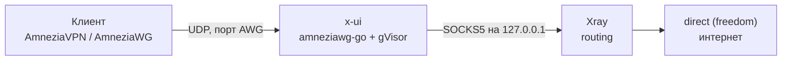

# Настройка 3x-ui + AmneziaWG с нуля (встроенный режим, amneziawg-go)

Пошаговая установка VPN-сервера на 3x-ui v3.11.0 и Ubuntu 26.04 с AmneziaWG во **встроенном режиме**: без модуля ядра, без `awg0` в системе и без NAT. Актуально на 28.10.2026.

Если что-то не работает после настройки, смотрите [README.md](README.md) — там диагностика «handshake есть, интернета нет».

## Содержание

0. [Что получится](#0-что-получится)
1. [Что нужно заранее](#1-что-нужно-заранее)
2. [Подготовка сервера](#2-подготовка-сервера)
3. [Установка 3x-ui](#3-установка-3x-ui)
4. [Первый вход и защита панели](#4-первый-вход-и-защита-панели)
5. [Проверка настроек Xray](#5-проверка-настроек-xray)
6. [Создание inbound AmneziaWG](#6-создание-inbound-amneziawg)
7. [Добавление клиента](#7-добавление-клиента)
8. [Подключение на устройстве](#8-подключение-на-устройстве)
9. [Проверка, что всё работает](#9-проверка-что-всё-работает)
10. [Обслуживание](#10-обслуживание)

---

## 0. Что получится

AmneziaWG работает **внутри процесса панели**: x-ui запускает встроенный `amneziawg-go` поверх userspace-стека gVisor. Расшифрованный трафик каждого клиента уходит в отдельный служебный SOCKS5-inbound Xray на loopback. Дальше работает обычная маршрутизация Xray: routing, sniffing, статистика по клиентам.



Что из этого следует:

- Модуль ядра, DKMS, `awg-quick` и пакеты `amneziawg-tools` **не нужны**: панель несёт собственный закреплённый `amneziawg-go`.
- `ip_forward`, MASQUERADE и правила FORWARD **не нужны**: в интернет выходит Xray.
- В `ip a` интерфейса `awg0` не будет, это нормально.
- Есть ещё опциональный **Kernel mode**. В этой инструкции он **выключен**: ему нужен модуль ядра, и в нём не работают routing и sniffing Xray.

## 1. Что нужно заранее

- VPS на **Ubuntu 26.04** с публичным IPv4, доступ по SSH под root или через `sudo`.
- Свободный **UDP-порт** для AmneziaWG, например `51820` или любой высокий порт.
- Если у хостера есть свой фаервол (security group, «Сетевой фильтр» и т. п.), право открывать в нём порты.
- Клиентское приложение с поддержкой **AmneziaWG 3.1**: свежий **AmneziaVPN** или **AmneziaWG**. Старые версии не поймут новые параметры обфускации (см. раздел 8).

## 2. Подготовка сервера

1. **Обновите систему и поставьте базовые утилиты:**
   ```bash
   sudo apt update && sudo apt full-upgrade -y
   sudo apt install -y curl ca-certificates
   ```

2. **Проверьте синхронизацию времени.** WireGuard-подобные протоколы чувствительны к сильному расхождению часов:
   ```bash
   timedatectl
   ```
   Должно быть `System clock synchronized: yes`. Если нет: `sudo timedatectl set-ntp true`.

3. **Проверьте выход сервера в интернет:**
   ```bash
   curl -4 -sS https://www.cloudflare.com/cdn-cgi/trace
   ```

4. **Откройте порты в ufw.** Сначала SSH, иначе можно потерять доступ к серверу. Номер порта панели вы узнаете после установки (раздел 3), поэтому эти команды можно выполнить и после неё.
   ```bash
   sudo ufw allow OpenSSH
   sudo ufw allow <порт_панели>/tcp
   sudo ufw allow <порт_AWG>/udp
   sudo ufw enable
   sudo ufw status verbose
   ```
   Для встроенного режима политику FORWARD в ufw менять не нужно.

5. **Откройте те же порты в фаерволе хостера**, если он есть: TCP для панели и **UDP** для AWG.

## 3. Установка 3x-ui

Запустите официальный скрипт от root:

```bash
sudo bash <(curl -Ls https://raw.githubusercontent.com/mhsanaei/3x-ui/master/install.sh)
```

Скрипт сам:

- скачает свежий релиз и проверит его по SHA-256;
- создаст службу systemd `x-ui` и включит автозапуск;
- сгенерирует **случайные** логин, пароль, порт и путь панели.

Выведенные данные сохраните. Они также записаны в файл, доступный только root:

```bash
sudo cat /etc/x-ui/install-result.env
```

Там будут `XUI_USERNAME`, `XUI_PASSWORD`, `XUI_PANEL_PORT`, `XUI_WEB_BASE_PATH` и `XUI_ACCESS_URL`. Если файл потерялся: `x-ui` → пункт **View Current Settings** или `x-ui settings`.

Проверьте, что служба работает:

```bash
sudo systemctl status x-ui --no-pager
```

## 4. Первый вход и защита панели

1. Откройте в браузере адрес из `XUI_ACCESS_URL` (вида `http://<IP_сервера>:<порт>/<путь>`).
2. Сразу смените логин и пароль на свои надёжные: **Panel Settings** или `x-ui` → **Reset Username & Password**.
3. Включите **двухфакторную аутентификацию (2FA)** в Panel Settings.
4. Оставьте нестандартный порт и длинный случайный путь панели, которые сгенерировал установщик.
5. По возможности переведите панель на HTTPS: управление SSL есть в меню `x-ui`.

После 5 неудачных попыток входа с одного IP за 5 минут панель блокирует вход на 15 минут. Если заблокировали себя, просто подождите.

## 5. Проверка настроек Xray

До создания inbound убедитесь, что Xray выпускает трафик наружу: тогда клиенту будет куда выходить.

1. На **Overview** статус Xray должен быть **Running**.
2. **Настройки Xray → Outbounds:** первым в списке должен стоять `direct` с протоколом **freedom**. Всё, что не попало ни под одно правило, Xray отправляет в первый outbound.
3. **Domain strategy** у `direct`: `AsIs` или `UseIPv4`. Не ставьте `UseIPv6` или `ForceIPv6`, если у сервера нет IPv6.
4. **Routing:** не должно быть правил, отправляющих весь трафик в `blocked` или в WARP либо прокси, если вы их сознательно не настраивали. Поле routing script в Basics должно быть пустым.

На свежей установке шаблон по умолчанию обычно уже правильный. Чистые разделы `log`, `dns`, `outbounds` и `routing` лежат в [`configs/xray-template-parts.json`](configs/xray-template-parts.json), подробности — в [README, раздел 8](README.md#8-готовые-json-для-настроек-xray).

## 6. Создание inbound AmneziaWG

**Inbounds → Add Inbound**, протокол **AmneziaWG**.

| Поле | Что поставить | Зачем |
| --- | --- | --- |
| **Remark** | понятное имя, например `awg-main` | по нему inbound видно в списке и в логах |
| **Port** | ваш UDP-порт, например `51820` | тот же, что открыли в ufw и у хостера |
| **Subnet** | `10.8.1.0/24` | подсеть туннеля, из неё клиенты получают адреса. Не должна пересекаться с локальными сетями клиентов (`172.16.0.0/12`, `192.168.0.0/16` и т. п.) |
| **MTU** | оставить пустым | панель сама возьмёт 1420 − S4, но не меньше 1280. Если сайты будут виснуть, поставьте `1280` |
| **DNS (primary / secondary)** | `1.1.1.1` и `8.8.8.8` | попадут в конфиги клиентов. Адрес шлюза туннеля сюда не ставьте |
| **External interface** | пусто | нужно только для IPv6, панель найдёт сама |
| **Kernel mode** | **выключен** | иначе панель переключится на модуль ядра |
| **IPv6** | выключен | включайте, только если у сервера есть рабочий публичный IPv6 |

**Обфускация (Jc, Jmin, Jmax, S1–S4, H1–H4, I1–I5, HeaderProtectionKey и др.)** — оставьте значения, которые сгенерировала панель. Если нужен новый набор, нажмите **Regenerate**. Вручную их не правьте: при ошибке (например пересекающиеся H1–H4 или `S1 + 56 = S2`) интерфейс вообще не поднимется.

Сохраните inbound. Он должен появиться в списке включённым, без ошибок.

## 7. Добавление клиента

1. В строке inbound откройте меню и выберите **Add Client** (добавить клиента).
2. Задайте имя или email клиента, например `phone-nikita`. Ключи и адрес туннеля панель создаст сама.
3. При желании задайте лимит трафика и срок действия.
4. Сохраните и в списке клиентов возьмите конфиг одним из способов:
   - скачайте файл **`.conf`**;
   - скопируйте ссылку **`vpn://…`** (её понимают приложения AmneziaVPN и AmneziaWG);
   - покажите **QR-код** и отсканируйте его телефоном.

Конфиг выглядит примерно так (значения ваши):

```ini
[Interface]
PrivateKey = <приватный ключ клиента>
Address = 10.8.1.2/32
DNS = 1.1.1.1, 8.8.8.8
Jc = 4
Jmin = 65
Jmax = 220
S1 = 87
S2 = 44
S3 = 21
S4 = 9
H1 = ...
H2 = ...
H3 = ...
H4 = ...
I1 = <r 148>
HeaderProtectionKey = ...
# и другие параметры 3.1, если панель их выдала

[Peer]
PublicKey = <публичный ключ сервера>
AllowedIPs = 0.0.0.0/0, ::/0
Endpoint = <IP_сервера>:<порт_AWG>
PersistentKeepalive = 25
```

Конфиг содержит приватный ключ клиента. Не выкладывайте его в публичный репозиторий и не пересылайте в открытые чаты. **Один конфиг — одно устройство:** для телефона и ноутбука заведите разных клиентов.

## 8. Подключение на устройстве

1. Установите **AmneziaVPN** или **AmneziaWG** из официального источника (магазин приложений, GitHub Amnezia, сайт amnezia.org).
2. Импортируйте конфиг: файл `.conf`, ссылку `vpn://` или QR-код.
3. Подключитесь.

Если приложение ругается на неизвестные параметры или не подключается при правильном порте, скорее всего, оно не поддерживает AmneziaWG 3.1. Обновите приложение. Если обновить нельзя, очистите поля 3.1 в inbound (HeaderProtectionKey, ContentPaddingAddition, тайминги и т. п.): тогда панель выдаст конфиг, понятный старым клиентам.

**Локальная сеть при включённом VPN.** С `AllowedIPs = 0.0.0.0/0` весь трафик идёт в туннель. Чтобы оставался доступ к домашней или офисной сети (например `172.x` или `192.168.x`), включите в приложении опцию доступа к локальной сети или исключите эти подсети из маршрута.

## 9. Проверка, что всё работает

1. **Handshake.** На Overview откройте логи AmneziaWG: у клиента должен появиться свежий handshake.
2. **Интернет с клиента** (VPN включён):
   ```bash
   curl -I http://1.1.1.1
   nslookup google.com 1.1.1.1
   ```
   На Windows используйте `curl.exe`, на телефоне откройте любой сайт.
3. **Внешний IP** должен стать IP сервера. Проверка: https://www.cloudflare.com/cdn-cgi/trace, строка `ip=`.
4. **Лог Xray:** при открытии сайта видны строки вида `accepted ... [<тег inbound> -> direct]`.

Не проверяйте работу VPN через `ping`. ICMP через SOCKS-мост не проходит, поэтому `ping 8.8.8.8` не отвечает даже при исправном туннеле.

Если handshake есть, а интернета нет, переходите к [README.md](README.md): там диагностика по шагам.

## 10. Обслуживание

- **Обновление панели.** Перед обновлением сделайте копию базы:
  ```bash
  sudo cp /etc/x-ui/x-ui.db ~/x-ui.db.bak
  x-ui update
  ```
- **Меню управления:** команда `x-ui` (старт, стоп, перезапуск, логи, сброс логина и пароля, SSL, смена порта).
- **Логи службы:** `sudo journalctl -u x-ui -f`.
- **Смена обфускации.** После **Regenerate** все клиенты должны заново скачать конфиги: старые перестанут подключаться.
- **Песочница systemd (v3.10.0+).** Служба пишет только в свои папки. Если задаёте Xray свои пути к логам или файлам, добавьте их через `ReadWritePaths=` в `/etc/systemd/system/x-ui.service.d/20-local.conf`.

## Источники

- [Документация 3x-ui: AmneziaWG](https://github.com/MHSanaei/3x-ui/blob/main/docs/content/docs/en/config/amneziawg.mdx)
- [Документация 3x-ui: установка](https://github.com/MHSanaei/3x-ui/blob/main/docs/content/docs/ru/guide/installation.mdx)
- [Документация 3x-ui: первый вход](https://github.com/MHSanaei/3x-ui/blob/main/docs/content/docs/ru/guide/first-login.mdx)
- [Документация 3x-ui: порты и брандмауэр](https://github.com/MHSanaei/3x-ui/blob/main/docs/content/docs/ru/reference/ports-firewall.mdx)
- [Релизы 3x-ui](https://github.com/MHSanaei/3x-ui/releases)
